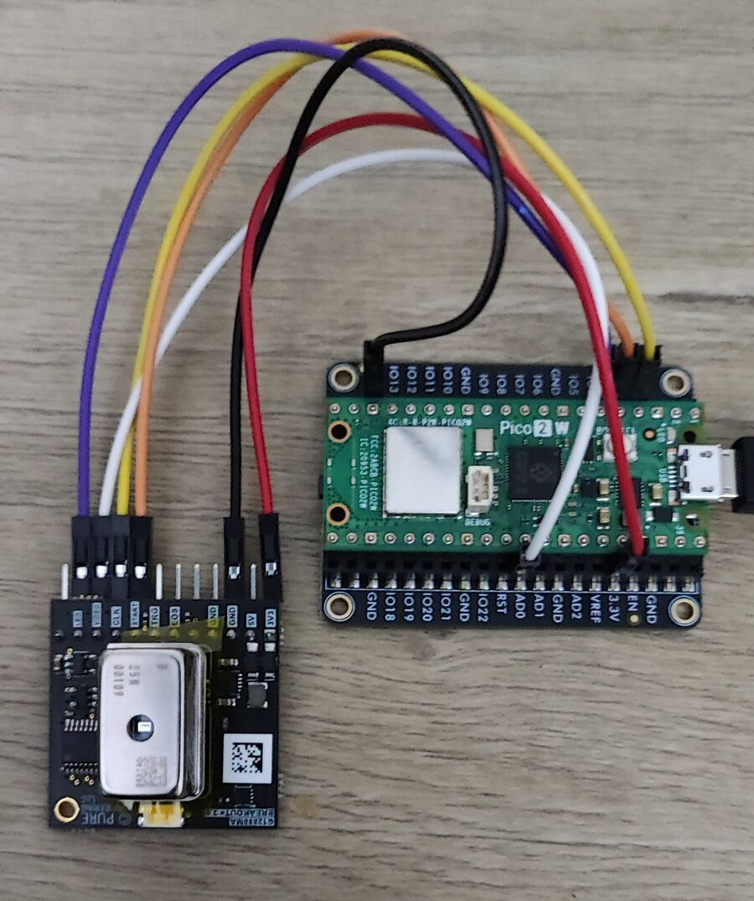
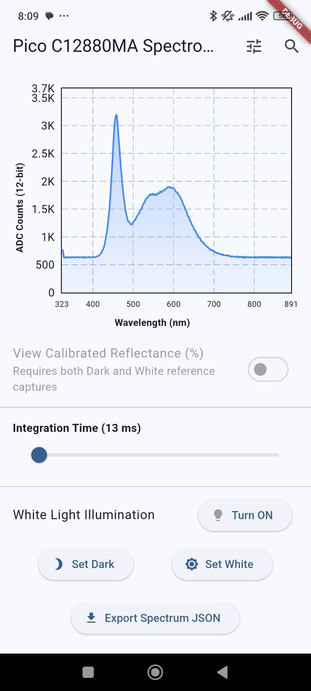
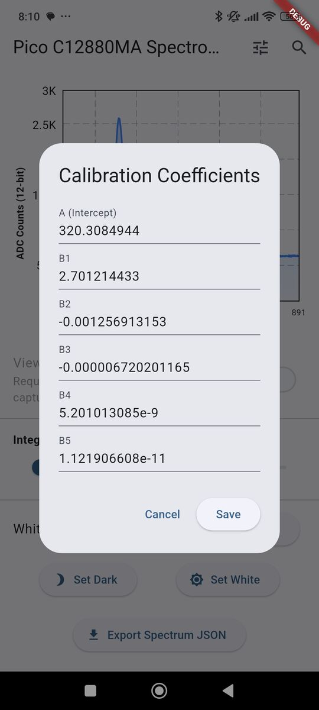

# Flutter C12880MA Spectroscopy App

This repository contains a Flutter mobile application for high-resolution spectroscopy. It uses **Bluetooth Low Energy (BLE)** to communicate with a **Raspberry Pi Pico 2W** connected to a **Hamamatsu C12880MA micro-spectrometer**.

## 📷 Photo & Screenshots
  

## 🛠️ Hardware Overview

The system utilizes the Hamamatsu C12880MA to capture continuous spectral data across 288 channels (pixels). The Raspberry Pi Pico 2W serves as the BLE peripheral, transmitting the 576-byte sensor payload to the mobile app.

## 📡 BLE GATT Profile & Communication

The Pico 2W acts as a peripheral exposing a custom service (`0xFF00`). Because of the large payload, the app implements specific MTU and subscription sequencing to prevent BLE buffer drops.

### Data Characteristics (NOTIFY)
The 288 channels are transmitted as 16-bit unsigned integers (Little Endian) split across three characteristics:
* **Pixels 0–95 (`0xFF01`):** 192 bytes.
* **Pixels 96–191 (`0xFF02`):** 192 bytes.
* **Pixels 192–287 (`0xFF03`):** 192 bytes.

### Control Characteristic (WRITE_WITHOUT_RESPONSE)
UUID `0xFF04` accepts dynamic-length command packets (`[Command ID] [Value Bytes...]`):
* **Cmd `0x01`:** Toggle White Illumination LED (`1` = On, `0` = Off) [2 Bytes Total].
* **Cmd `0x02`:** Set Integration Time in milliseconds (uint16_t, Little Endian) [3 Bytes Total].

## 📱 Application Features

The mobile app is built using **Flutter** and **Cubit (BLoC)** for state management.

* **Live Continuous Line Chart:** Visualizes all 288 pixels simultaneously using `fl_chart`.
* **Factory Wavelength Calibration:** Converts raw pixel indices to precise nanometer wavelengths using Hamamatsu's 5th-order polynomial equation ($\lambda = A + B_1p + B_2p^2 + B_3p^3 + B_4p^4 + B_5p^5$). Includes a UI dialog to input custom coefficients from your sensor's factory inspection sheet.
* **Reflectance Calibration:** Capture and save Dark and White reference spectra to calculate and display true reflectance percentages. 
* **Dynamic Controls:** Real-time toggling of the sensor's onboard white LED and a precise **Integration Time Slider (1 ms to 500 ms)** that wirelessly commands the firmware's true electronic shutter.
* **Data Export:** Save captured spectra, polynomial coefficients, and reference references to **JSON** using `file_picker`.
* **Robust BLE Connection:** Uses `flutter_blue_plus` with MTU requests >= 195 bytes and staggered CCCD subscriptions to handle the dense data stream reliably.

## 🚀 Getting Started

**1. Firmware (Pico 2W)**
* Flash your Raspberry Pi Pico 2W with the companion [C12880MA BLE Server firmware](https://github.com/IoT-gamer/pico_c12880ma_ble_server).

**2. Mobile App (Flutter)**
* Clone this repository.
* Run `flutter pub get` to install dependencies (`flutter_bloc`, `flutter_blue_plus`, `fl_chart`, `file_picker`, `equatable`).
* Connect an Android or iOS device and run `flutter run`.
* Grant Bluetooth and Location permissions when prompted.
* Tap the search icon to discover and connect to the `Pico-C12880MA` device.

## 📜 License
This project is licensed under the MIT License.